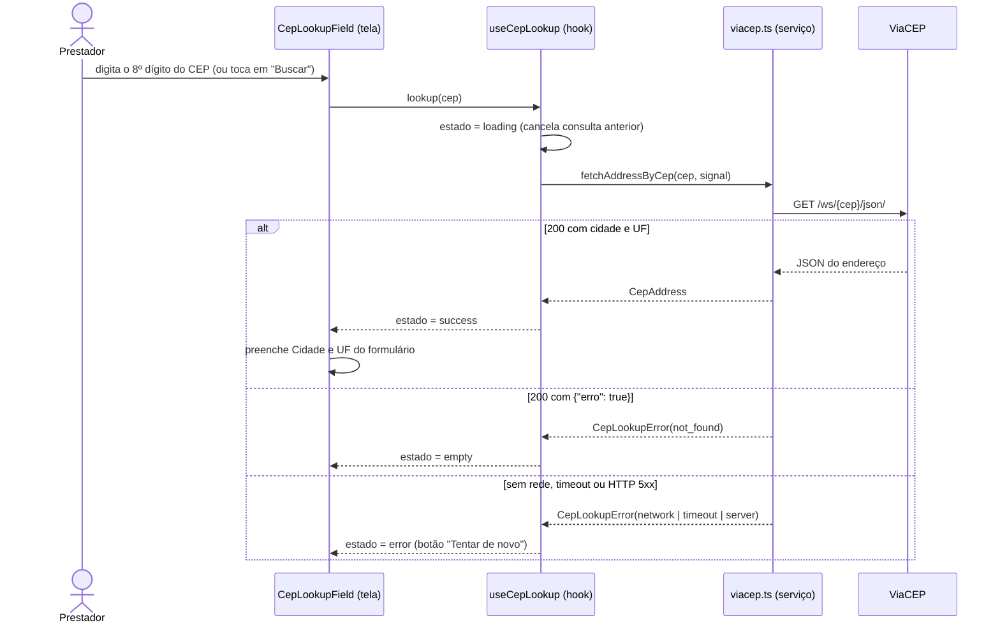
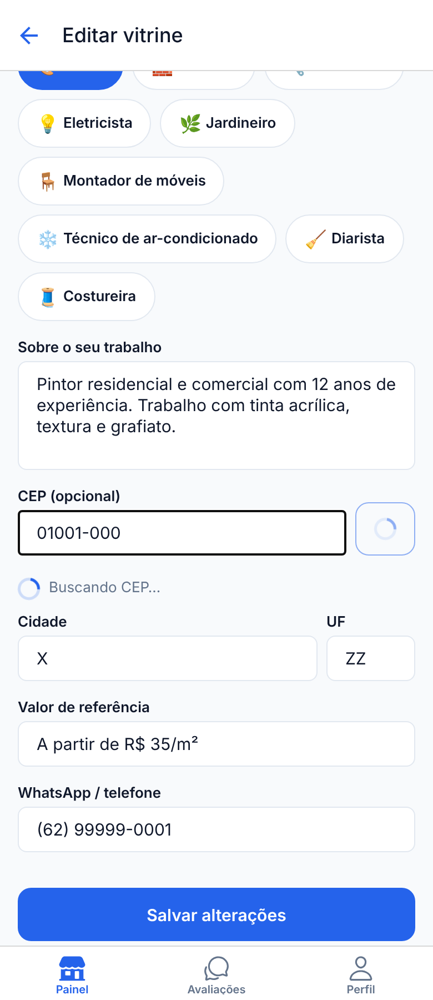
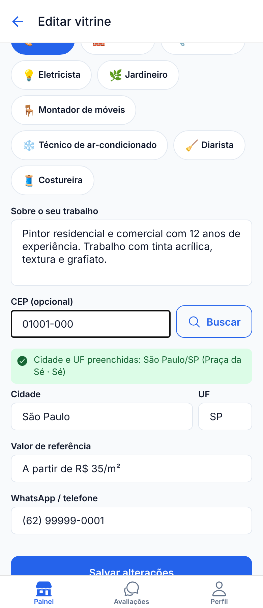
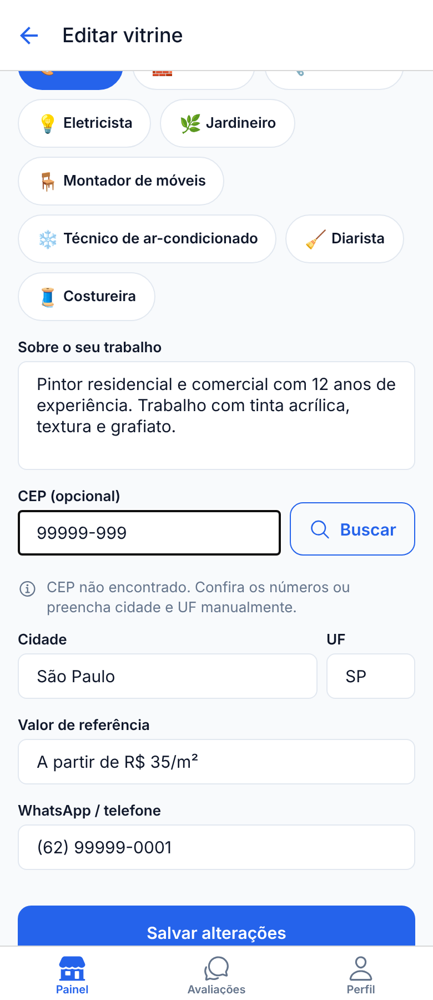
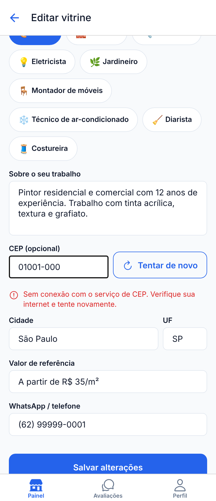

# Etapa 06: Integração com API ou Serviço Externo

Nesta etapa o app passa a se comunicar pela rede com um **serviço externo**: a API
pública **ViaCEP**. No cadastro e na edição da vitrine, o prestador digita o **CEP** e o
app consulta o serviço para **preencher cidade e UF automaticamente**, em vez de depender
de digitação manual (que gera cidades escritas de formas diferentes e atrapalha o filtro
de localização da busca).

| Exigência do enunciado | Onde está atendida |
| ---------------------- | ------------------ |
| Pelo menos um serviço externo, via HTTP | ViaCEP, `GET` HTTPS (seção 1) |
| Pelo menos uma operação de consulta, envio ou atualização | **Consulta** de endereço por CEP (seção 3) |
| Tratamento de carregamento, sucesso, erro e ausência de dados | Seção 6 |
| Documentar a API e o formato dos dados trocados | Seções 1 a 4 |
| Instruções para executar e testar, sem expor credenciais | Seções 7 e 8 |

## 1. Serviço utilizado

| Item | Valor |
| ---- | ----- |
| Serviço | **ViaCEP**: consulta pública e gratuita de CEPs brasileiros |
| Site / documentação | <https://viacep.com.br> |
| URL base | `https://viacep.com.br/ws` |
| Protocolo | HTTPS, método `GET`, resposta em JSON |
| Autenticação | **Nenhuma**: não há chave, token nem cadastro |
| Cliente HTTP | `fetch` nativo do React Native (sem biblioteca extra) |

**Por que este serviço?** O app é voltado a prestadores de serviço no Brasil, e a
localização (cidade/UF) é o principal filtro da busca. A consulta por CEP encaixa no
escopo, não exige credenciais (nada sensível no repositório) e tem um contrato simples
para documentar e testar.

## 2. Endpoint utilizado

| Operação | Método | Endpoint | Onde é chamado |
| -------- | ------ | -------- | -------------- |
| Consultar endereço por CEP | `GET` | `{URL base}/{cep}/json/` | `fetchAddressByCep` em [`src/services/viacep.ts`](../src/services/viacep.ts) |

- `{cep}`: **8 dígitos, sem máscara** (ex.: `01001000`). O app remove pontos e hífen antes
  de enviar e só dispara a requisição com os 8 dígitos completos.
- Cabeçalho enviado: `Accept: application/json`. Não há corpo na requisição.
- Não há outros endpoints em uso (a busca por logradouro do ViaCEP não foi necessária).

Exemplo de requisição:

```http
GET https://viacep.com.br/ws/01001000/json/
Accept: application/json
```

## 3. Estrutura dos dados

### 3.1 Dados enviados

Apenas o CEP, no caminho da URL. Não há corpo nem dados pessoais do usuário na requisição.

### 3.2 Dados recebidos (sucesso: HTTP 200)

```json
{
  "cep": "01001-000",
  "logradouro": "Praça da Sé",
  "complemento": "lado ímpar",
  "bairro": "Sé",
  "localidade": "São Paulo",
  "uf": "SP",
  "ibge": "3550308",
  "gia": "1004",
  "ddd": "11",
  "siafi": "7107"
}
```

(A API pode devolver campos adicionais, como `unidade`, `estado` e `regiao`; o app ignora
tudo o que não usa.)

### 3.3 CEP inexistente (HTTP 200 com `erro`)

Quando o CEP tem formato válido mas não existe na base, o ViaCEP **não** responde 404: ele
responde 200 com este corpo, que o app trata como "ausência de dados":

```json
{ "erro": true }
```

(Versões antigas da API devolviam `"erro": "true"`; o app aceita as duas formas.)

### 3.4 CEP malformado (HTTP 400)

Para CEP com formato inválido o ViaCEP responde 400 com uma página HTML, não JSON. O app já
valida o formato antes de chamar a API, então isso só ocorreria por mudança no serviço; ainda
assim é tratado (como "CEP inválido") em vez de quebrar ao interpretar o corpo.

### 3.5 Conversão para o formato do app

A resposta é convertida no tipo `CepAddress` (nomes em inglês, só o que o app usa):

| Campo da API | Campo do app (`CepAddress`) | Uso |
| ------------ | --------------------------- | --- |
| `cep` | `cep` (8 dígitos, sem máscara) | informativo |
| `logradouro` | `street` | exibido na mensagem de sucesso |
| `bairro` | `neighborhood` | exibido na mensagem de sucesso |
| `localidade` | `city` | **preenche o campo Cidade** do formulário |
| `uf` | `state` (maiúsculas) | **preenche o campo UF** do formulário |

O que é salvo no aparelho continua sendo só `city` e `state` da vitrine (Etapa 04); o CEP
não é armazenado.

## 4. Configuração do serviço

O ViaCEP **não exige nenhuma credencial**, então não há segredo a configurar. A URL base e
o tempo limite ficam em [`src/config/api.ts`](../src/config/api.ts):

| Configuração | Padrão | Como alterar |
| ------------ | ------ | ------------ |
| URL base | `https://viacep.com.br/ws` | variável de ambiente `EXPO_PUBLIC_VIACEP_URL` |
| Tempo limite da requisição | 8 segundos (`REQUEST_TIMEOUT_MS`) | constante em `src/config/api.ts` |

Para sobrescrever, copie [`.env.example`](../.env.example) para `.env` (o `.env` está no
`.gitignore` e **não** vai para o repositório) e reinicie o Metro com cache limpo:
`npx expo start -c`. A variável é opcional: sem ela vale o padrão.

> **Atenção:** variáveis `EXPO_PUBLIC_*` são embutidas no app e ficam visíveis a quem o
> instala. Elas servem para endereços e flags, **nunca** para chaves privadas ou tokens. Se
> uma etapa futura exigir uma chave secreta (ex.: Supabase `service_role`), ela deve ficar
> num servidor, não no app.

## 5. Fluxo de comunicação



Camadas (cada uma com uma responsabilidade):

| Arquivo | Responsabilidade |
| ------- | ---------------- |
| [`src/config/api.ts`](../src/config/api.ts) | URL base e tempo limite |
| [`src/services/viacep.ts`](../src/services/viacep.ts) | Só HTTP: monta a URL, aplica timeout, valida a resposta e converte para `CepAddress`. Classifica as falhas em `CepLookupError` (`invalid`, `not_found`, `network`, `timeout`, `server`). Não conhece React. |
| [`src/hooks/useCepLookup.ts`](../src/hooks/useCepLookup.ts) | Máquina de estados da tela (`idle`, `loading`, `success`, `empty`, `error`), mensagens ao usuário e cancelamento. |
| [`src/components/CepLookupField.tsx`](../src/components/CepLookupField.tsx) | Campo de CEP com máscara, botão e mensagem de status. |
| [`src/components/ProviderProfileForm.tsx`](../src/components/ProviderProfileForm.tsx) | Recebe o endereço e preenche `city`/`state` do formulário. Usado em "Monte sua vitrine" e em "Editar vitrine". |

## 6. Tratamento dos estados

| Estado | Quando ocorre | O que o usuário vê |
| ------ | ------------- | ------------------ |
| **Carregamento** | requisição em andamento | botão com indicador de progresso e a mensagem "Buscando CEP…" |
| **Sucesso** | API devolveu cidade e UF | mensagem verde "Cidade e UF preenchidas: São Paulo/SP (Praça da Sé · Sé)" e os campos Cidade/UF preenchidos (editáveis) |
| **Ausência de dados** | CEP com formato válido que não existe (`{"erro": true}`) | "CEP não encontrado. Confira os números ou preencha cidade e UF manualmente." Os campos **não** são alterados |
| **Erro** | sem conexão, tempo esgotado (8 s), erro HTTP/resposta inesperada, ou CEP com menos de 8 dígitos | mensagem em vermelho específica para cada causa; nas falhas de rede/tempo/servidor o botão vira **"Tentar de novo"** |

Mensagens de erro por causa:

| Causa (`CepErrorKind`) | Mensagem |
| ---------------------- | -------- |
| `invalid` (menos de 8 dígitos; **nenhuma requisição é feita**) | "Digite os 8 números do CEP." |
| `network` | "Sem conexão com o serviço de CEP. Verifique sua internet e tente novamente." |
| `timeout` | "O serviço de CEP demorou para responder. Tente novamente." |
| `server` | "O serviço de CEP está com problemas no momento. Tente novamente em instantes." |

Decisões de robustez:

- **A integração nunca bloqueia o cadastro.** O CEP é opcional: com a API fora do ar, o
  prestador preenche cidade e UF à mão e publica a vitrine normalmente.
- **Só a última consulta vale.** Se o usuário digita outro CEP enquanto uma consulta está em
  andamento, a anterior é cancelada (`AbortController`) e sua resposta é descartada, evitando
  que uma resposta lenta sobrescreva uma mais nova.
- **Editar o CEP limpa o resultado anterior** (o status deixa de valer).
- **Ao sair da tela**, a consulta pendente é cancelada (não atualiza componente desmontado).
- **Acessibilidade:** a área de status é uma região "live" e cada mudança de estado também é
  anunciada com `AccessibilityInfo.announceForAccessibility` (mesmo padrão do toast da
  Etapa 03). O texto de sucesso usa o novo token de cor `successText`
  (`#166534`, contraste 7,1:1), já que o `success` (`#16A34A`) não passa em AA como texto.
  O botão mantém altura mínima de 48 px.

## 7. Como executar

```bash
npm install
npx expo start        # Expo Go no celular, ou a/i/w para Android/iOS/Web
```

Em redes institucionais use `npm run tunnel` (ver README). O app precisa de **acesso à
internet** para a consulta de CEP (o restante continua funcionando offline).

## 8. Como testar a integração

Entre como prestador (`prestador@email.com` / `Teste@123`), abra **Painel → Editar vitrine**
(ou crie uma conta de Prestador para cair em "Monte sua vitrine") e vá até o campo
**CEP (opcional)**, acima de Cidade/UF.

| # | Cenário | Como provocar | Resultado esperado |
| - | ------- | ------------- | ------------------ |
| 1 | Sucesso | digite `01001-000` | "Cidade e UF preenchidas: São Paulo/SP (Praça da Sé · Sé)"; Cidade = São Paulo, UF = SP |
| 2 | Carregamento | repita o cenário 1 com a rede lenta (web: DevTools → Network → *Slow 3G*) | "Buscando CEP…" e botão com indicador enquanto espera |
| 3 | Ausência de dados | digite `99999-999` | "CEP não encontrado…"; Cidade/UF **não** mudam |
| 4 | Erro de rede | ative o modo avião (ou aponte `EXPO_PUBLIC_VIACEP_URL=http://127.0.0.1:9` no `.env`, rode `npx expo start -c`) e digite um CEP | "Sem conexão com o serviço de CEP…" e botão "Tentar de novo" |
| 5 | Nova tentativa | desfaça o modo avião e toque em "Tentar de novo" | passa a "Buscando CEP…" e depois sucesso |
| 6 | CEP incompleto | digite `1234` e toque em "Buscar" | "Digite os 8 números do CEP."; nenhuma requisição é feita |
| 7 | Editar o CEP | após um sucesso, apague um dígito | a mensagem some; Cidade/UF preenchidas permanecem para edição |
| 8 | Uso no cadastro | em "Monte sua vitrine", preencha o CEP, complete o formulário e publique | vitrine criada com a cidade/UF obtidas; aparece na Busca ao filtrar por essa cidade |

## 9. Verificação feita nesta etapa

| Verificação | Como foi feita | Resultado |
| ----------- | -------------- | --------- |
| Tipagem | `npx tsc --noEmit` | sem erros |
| Camada de serviço (`viacep.ts`) | script com `fetch` simulado: sucesso, `erro: true`, `erro: "true"`, resposta sem cidade, HTTP 400/404/500, corpo não-JSON, rede caída, **timeout real de 8 s**, cancelamento pelo chamador, máscara/validação de CEP | 11 de 11 cenários corretos; a URL chamada foi `GET https://viacep.com.br/ws/01001000/json/` |
| Interface (build web, Chromium automatizado, resposta da API simulada) | carregamento → sucesso (campos preenchidos), CEP inexistente, rede caída → "Tentar de novo" → sucesso, HTTP 500, CEP incompleto (0 requisições), edição limpando o status, e consulta antiga lenta não sobrescrevendo a nova | todos os estados e transições conforme a seção 6; sem erros no console |

**Limitações da verificação:**

- As respostas da API foram **simuladas**; a chamada ao ViaCEP real e a execução em celular
  (Expo Go) devem ser repetidas seguindo a seção 8 antes da entrega. Registre aqui o
  resultado: `[ ] cenário 1 com a API real` · `[ ] cenários 4–5 no celular`.
- Como na Etapa 04, VoiceOver/TalkBack não foram testados com o leitor de tela ligado.

Capturas da interface (respostas da API simuladas), na ordem carregamento, sucesso,
ausência de dados e erro:

| Carregamento | Sucesso | Ausência de dados | Erro |
| :----------: | :-----: | :---------------: | :--: |
|  |  |  |  |

## 10. Limitações e próximos passos

- O CEP não é guardado; só cidade e UF entram na vitrine. Guardar bairro/CEP permitiria
  filtrar por bairro em etapa futura.
- Não há cache de consultas: cada CEP digitado gera uma requisição.
- A integração com o Supabase (autenticação, banco e imagens), prevista para as próximas
  etapas, será um segundo serviço externo; a mesma estrutura (`config` → `services` →
  hook → tela) deve ser reutilizada.
