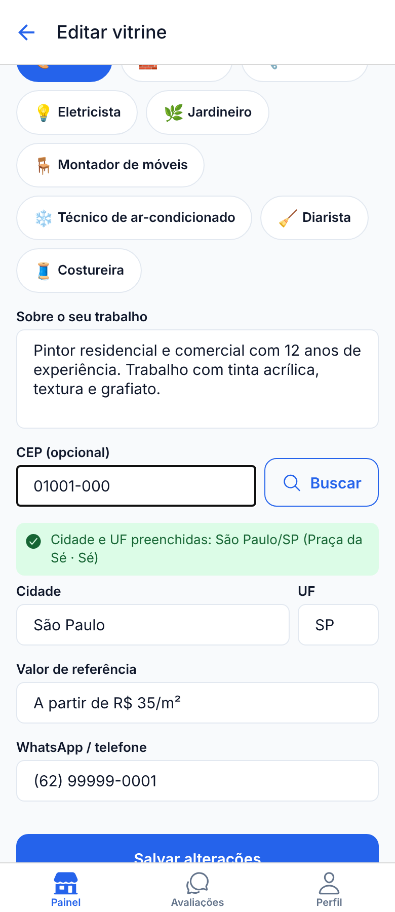

# Evidências de Funcionamento

> Este documento reunirá, a cada etapa, evidências (prints ou vídeos curtos) do
> funcionamento da aplicação.

## Etapa 01

Etapa de proposta e planejamento — não há funcionalidades executáveis nesta
fase. As evidências de funcionamento passarão a ser incluídas a partir da
próxima etapa.

## Etapa 02

## Etapa 06

Integração com a API ViaCEP (consulta de CEP). Capturas dos quatro estados
(carregamento, sucesso, ausência de dados e erro), obtidas na versão web com respostas da
API simuladas, em [`docs/etapa-06.md`](etapa-06.md#9-verificação-feita-nesta-etapa):

Pendente de registro: execução com a API real e em aparelho (roteiro na seção 8 do mesmo
documento).
